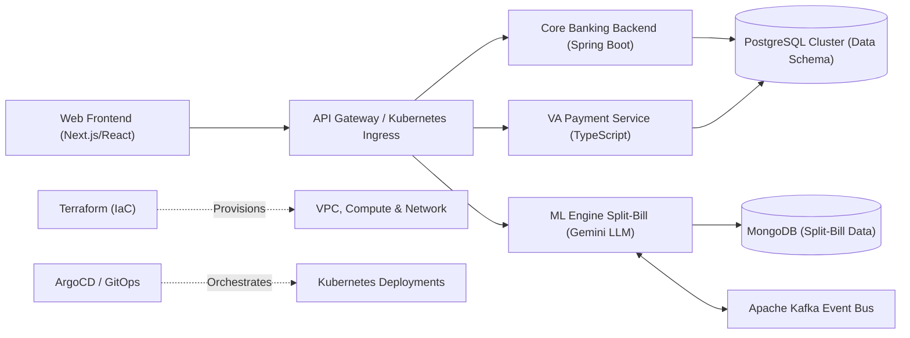

<!-- Header Dynamic Banner -->

<!-- Typing Dynamic Title Animation -->

 

<!-- Social Badges & Status -->

---

### 👨‍💻 Executive Summary

- 🎓 **Informatics Engineering (Teknik Informatika)** graduate from **Institut Teknologi Bandung (ITB)**.
- 📄 **Published IEEE Researcher**: Co-authored [*"Sentence Embedding-based Soft Clustering for Analyzing Texts of Student Outcomes"*](https://ieeexplore.ieee.org/document/10829879) presented at IEEE ICoDSE 2024.
- 🏦 **Enterprise Fintech & Banking Engineering**: Engineered production-grade digital banking microservices for **Orange Wallet (Fintech Capstone Mini-Project)**, implementing Virtual Account Payment, Core Banking Spring Boot, Terraform IaC, and Kubernetes GitOps.
- 🤖 **Applied AI & Intelligent Agents**: Architected deterministic LLM token budgeting engines (**`context-assembler`**), zero-SDK OS-sandboxed MCP execution runtime (**`aegis-mcp`**), multi-agent NLQ-to-SQL conversational BI assistants (LangGraph), multimodal split-bill engines (Gemini LLM), time-series liquidity forecasting models, and RAG assistants.
- 🏛️ **Proven Executive Leadership**: Former [**Head of KAT ITB 2023**](https://itb.ac.id/berita/penutupan-oskm-itb-2023-keseruan-pertunjukan-seni-hingga-momen-haru-salam-ganesha/59778) (ITB Centralized Freshman Orientation) — managed an operational budget of **~Rp1 Billion IDR**, leading a **2,300-member cross-functional committee** to successfully onboard and orient **5,300+ incoming university students**.
- 📬 **Let's Connect**: Open for collaboration on enterprise software, cloud infrastructure, and AI engineering at [stevensiahaan25@gmail.com](mailto:stevensiahaan25@gmail.com).

---

### 📄 Academic Publication

> **[Sentence Embedding-based Soft Clustering for Analyzing Texts of Student Outcomes](https://ieeexplore.ieee.org/document/10829879)**  
> *Steven Gianmarg Haposan Siahaan, Masayu Leylia Khodra*  
> **2024 IEEE International Conference on Data and Software Engineering (ICoDSE)**  
> 🏷️ `DOI: 10.1109/ICoDSE63640.2024.10829879` | `IEEE Xplore: 10829879`  
> 💡 *A soft clustering approach utilizing state-of-the-art sentence embeddings to analyze unstructured competency text data from tracer studies.*

---

### 📜 Licenses & Verified Certifications

| Certification / Specialization | Issuer / Platform | Verification & Validity |
| :--- | :--- | :---: |
| **TensorFlow Developer Certificate** | TensorFlow | [Verify Certificate ↗](https://www.credential.net/cfeecf45-6a3c-4b4d-a707-147daf95bdb2) *(Valid until October 3, 2027)* |
| **Microsoft Certified: Azure AI Fundamentals (AI-900)** | Microsoft | [View Score Report ↗](https://drive.google.com/file/d/1jrniF0w271xKiHLlyPT6ZcBQt6SnzkmD/view?usp=sharing) *(Score: 982/1000 — Pass)* |
| **Deep Learning Specialization** | Coursera (DeepLearning.AI) | [Verify Specialization ↗](https://coursera.org/verify/professional-cert/VCGC2X54YML3) |
| **Machine Learning Specialization** | Coursera (Stanford & DeepLearning.AI) | [Verify Specialization ↗](https://coursera.org/verify/specialization/QGKXANQFLBUN) |
| **Google Data Analytics Specialization** | Coursera (Google) | [Verify Specialization ↗](https://coursera.org/verify/professional-cert/6MJXUWA45NVN) |
| **Mathematics for Machine Learning and Data Science** | Coursera (DeepLearning.AI) | [Verify Specialization ↗](https://coursera.org/verify/specialization/Q355YPY723WX) |
| **Data and Deployment Specialization** | Coursera (DeepLearning.AI) | [Verify Specialization ↗](https://coursera.org/verify/specialization/PV5J9J7UAY6D) |
| **Structuring Machine Learning Projects** | Coursera (DeepLearning.AI) | [Verify Course ↗](https://coursera.org/verify/C4SBYRJ2ZUB9) |

---

### 💻 Core Tech Stack

| Domain | Technologies, Libraries & Tools |
| :--- | :--- |
| **Languages** |        |
| **AI, Deep Learning & Agents** |          |
| **Big Data & Data Eng** |       |
| **Enterprise & Microservices** |         |
| **Cloud, DevOps & Infra** |         |
| **Observability & SRE** |        |

---

### 🚀 Flagship Engineering Showcases

#### 🤖 **1. Applied AI, Multi-Agent & Intelligent Systems**

| Project | Highlights & Capabilities | Built With |
| :--- | :--- | :--- |
| [**`aegis-mcp`**](https://github.com/StevenSiahaann/aegis-mcp) | **Zero-SDK OS-Sandboxed Filesystem & Execution MCP Server** Enterprise-grade, zero-external-dependency Model Context Protocol (MCP) server enforcing strict kernel isolation (macOS Seatbelt `sandbox-exec` / Linux Bubblewrap `bwrap`), AST-based CLI sanitization, memory-bounded 64KB streaming, and recursive regex PII/credential redaction. | `Python` `MCP Protocol` `OS Sandbox` `Security` `Kernel Isolation` |
| [**`context-assembler`**](https://github.com/StevenSiahaann/context-assembler) | **Deterministic Token Budgeting & LLM Context Assembly Engine** Zero-overflow context assembler for LLM agents, featuring priority-based water-filling budget allocation, KV prompt cache optimization (~51% cost savings), and atomic tool-pairing eviction. | `Python` `LLM Context` `Algorithms` `Pyright Strict` |
| [**`conversational-bi-agent`**](https://github.com/StevenSiahaann/conversational-bi-agent) | **Conversational BI Agent (NLQ → SQL)** Natural language to SQL analytics assistant built with a LangGraph multi-agent architecture (Commander + specialized subagents) for schema resolution and business queries. | `LangGraph` `FastAPI` `PostgreSQL` `DuckDB` `Docker` |
| [**`ml-engine-capstone-orange`**](https://github.com/StevenSiahaann/ml-engine-capstone-orange) | **Multimodal AI Split-Bill & Receipt Parsing Engine** Multimodal LLM (Gemini) receipt parsing pipeline, automated itemization & participant bill splitting, Kafka event streaming, and MongoDB persistence. | `Gemini LLM` `Python` `Kafka` `MongoDB` `FastAPI` |
| [**`agentic-starter-kit`**](https://github.com/StevenSiahaann/agentic-starter-kit) | **Autonomous Agent Starter Kit & Test Harness** Developer starter kit and automated verification test harness for building reliable AI agent workflows, featuring architectural guardrails and evaluation tests. | `TypeScript` `Node.js` `Autonomous Agents` `Testing Harness` |
| [**`hybrid-forecasting-modelling`**](https://github.com/StevenSiahaann/hybrid-forecasting-modelling) | **Hybrid Time-Series Forecasting (Statistical & ML)** Experimental banking liquidity forecasting on historical deposit and loan data (*simpanan & pinjaman*), blending classical statistical models (ARIMA/SARIMAX) with deep learning architectures. | `Python` `Statsmodels` `PyTorch` `Time-Series` |
| [**`customer-segmentation`**](https://github.com/StevenSiahaann/customer-segmentation) | **Customer Behavioral Segmentation & Product Recommendation** Behavioral clustering pipeline grouping business clients by transaction patterns and service usage using K-Means and RFM, paired with Apriori recommendation rules and a lightweight Streamlit dashboard. | `Python` `Scikit-learn` `Streamlit` `Clustering` |
| [**`credit-risk-mlops-pipeline`**](https://github.com/StevenSiahaann/credit-risk-mlops-pipeline) | **End-to-End MLOps Pipeline: Credit Card Default Risk** Integrated MLOps workflow: automated data preprocessing via GitHub Actions CI/CD, experiment tracking with MLflow & DagsHub, and automated container builds published to Docker Hub. | `Python` `MLflow` `Docker` `GitHub Actions` |
| [**`rag-chatbot`**](https://github.com/StevenSiahaann/rag-chatbot) | **Interactive RAG Knowledge Assistant** Contextual QA with in-memory vector indexing, dynamic prompt orchestration, and an interactive Streamlit interface. | `Python` `Streamlit` `VectorDB` `LangChain` |
| [**`rag-harpa`**](https://github.com/StevenSiahaann/rag-harpa) | **Internal HR Policy Assistant & Self-Service RAG** RAG backend using ChromaDB for company policy Q&A, integrated with internal employee APIs to query leave balances, medical benefit limits, and pending approvals. | `Python` `Flask` `ChromaDB` `Gemini AI` |
| [**`ml-flutter-template`**](https://github.com/StevenSiahaann/ml-flutter-template) | **Cross-Platform Mobile AI Application** Mobile application template integrating on-device and cloud machine learning models with Flutter and Firebase. | `Flutter` `Dart` `Firebase` `Mobile ML` |

 

#### 🏦 **2. Orange Wallet: Enterprise Digital Banking Ecosystem**
*A resilient, high-availability digital wallet & banking platform engineered with clean microservices and declarative infrastructure (Capstone Mini-Project).*

| Repository | Component & Architecture Role | Core Technologies |
| :--- | :--- | :--- |
| [**`orange-infrastructure-as-code`**](https://github.com/StevenSiahaann/orange-infrastructure-as-code) | Automated infrastructure provisioning, production VPC, and node pools via Terraform. | `Terraform (HCL)` `Cloud VPC` `IAM` |
| [**`va-payment`**](https://github.com/StevenSiahaann/va-payment) | High-concurrency Virtual Account payment and transaction settlement service. | `TypeScript` `Node.js` `REST API` |
| [**`ml-engine-capstone-orange`**](https://github.com/StevenSiahaann/ml-engine-capstone-orange) | Multimodal AI engine for receipt parsing, automated split-bill cost distribution, and Kafka event streaming. | `Python` `Gemini AI` `Kafka` `MongoDB` |
| [**`orange-wallet-gitops`**](https://github.com/StevenSiahaann/orange-wallet-gitops) | Declarative GitOps continuous deployment pipeline for microservices (Sanitized templates). | `Kubernetes` `GitOps` `ArgoCD` |
| [**`be-capstone-project`**](https://github.com/StevenSiahaann/be-capstone-project) | Core banking ledger, account balances, and Spring Cloud config integrations. | `Java` `Spring Boot` `Spring Cloud` |
| [**`data-schema`**](https://github.com/StevenSiahaann/data-schema) | Production relational schemas, double-entry ledgers, seeders, and migration scripts. | `PostgreSQL` `PLpgSQL` `Protobuf` |
| [**`simple-dashboard`**](https://github.com/StevenSiahaann/simple-dashboard) | Customer satisfaction analytics and user feedback dashboard (early MVP iteration for CSAT metrics). | `Python` `Analytics` `Streamlit` |
| [**`fe-capstone-project-refactor`**](https://github.com/StevenSiahaann/fe-capstone-project-refactor) | Responsive customer-facing digital wallet portal. | `JavaScript` `React` `Next.js` |

---

### 📊 GitHub Activity & Metrics

  

  

---

  Crafted with passion by <a href="https://github.com/StevenSiahaann">Steven Gianmarg Siahaan</a>

